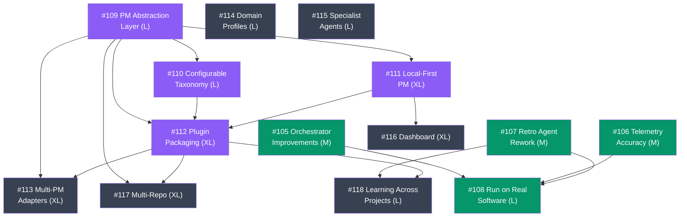

# Roadmap

> **Last updated:** 2026-03-16
> **Work tracking:** [Project Board](https://github.com/users/carlosboeing/projects/7)
> **Analysis & research:** [docs/1-discovery/2026-03-15-roadmap.md](1-discovery/2026-03-15-roadmap.md)

## Dependency Graph

🟢 Active (ready now) · 🟣 Plugin track · ⚫ Future ideas

## Priority Order

| Priority | Issue | Title | Size | Dependencies | Track |
|----------|-------|-------|------|-------------|-------|
| 1 | [#105](https://github.com/carlosboeing/agentic-sdlc-workflow/issues/105) | Orchestrator Improvements | M | — | Active |
| 2 | [#106](https://github.com/carlosboeing/agentic-sdlc-workflow/issues/106) | Telemetry Accuracy & Automation | M | — | Active |
| 3 | [#107](https://github.com/carlosboeing/agentic-sdlc-workflow/issues/107) | Retro Agent Rework | M | — | Active |
| 4 | [#108](https://github.com/carlosboeing/agentic-sdlc-workflow/issues/108) | Run on Real Software | L | 105, 106, 107 | Active |
| 5 | [#109](https://github.com/carlosboeing/agentic-sdlc-workflow/issues/109) | PM Abstraction Layer | L | — | Plugin |
| 6 | [#110](https://github.com/carlosboeing/agentic-sdlc-workflow/issues/110) | Configurable Taxonomy | L | 109 | Plugin |
| 7 | [#111](https://github.com/carlosboeing/agentic-sdlc-workflow/issues/111) | Local-First PM System | XL | 109 | Plugin |
| 8 | [#112](https://github.com/carlosboeing/agentic-sdlc-workflow/issues/112) | Plugin Packaging | XL | 109, 110, 111 | Plugin |
| 9 | [#113](https://github.com/carlosboeing/agentic-sdlc-workflow/issues/113) | Multi-PM Adapters | XL | 109, 112 | Future |
| 10 | [#114](https://github.com/carlosboeing/agentic-sdlc-workflow/issues/114) | Domain Profiles | L | — | Future |
| 11 | [#115](https://github.com/carlosboeing/agentic-sdlc-workflow/issues/115) | New Specialist Agents | L | — | Future |
| 12 | [#116](https://github.com/carlosboeing/agentic-sdlc-workflow/issues/116) | Dashboard | XL | 111 | Future |
| 13 | [#117](https://github.com/carlosboeing/agentic-sdlc-workflow/issues/117) | Multi-Repo Orchestration | XL | 109, 112 | Future |
| 14 | [#118](https://github.com/carlosboeing/agentic-sdlc-workflow/issues/118) | Learning Across Projects | L | 107, 112 | Future |

## Backlog Summaries

### Active Track

**[#105 Orchestrator Improvements](https://github.com/carlosboeing/agentic-sdlc-workflow/issues/105)** — `size/M`
Bundle of orchestrator enhancements: Sonnet reviews for easy stories, early story branch creation, streaming reviews (review as each builder finishes), batched board updates, batch issue creation in planner, format templates for parallel content, orchestrator override pattern documentation, and orchestrator overhead metrics.

**[#106 Telemetry Accuracy & Automation](https://github.com/carlosboeing/agentic-sdlc-workflow/issues/106)** — `size/M`
Fix hand-crafted Gantt charts by generating them from state data with precise timestamps. Extract the 602-line `issue-telemetry.sh` dispatch computation into a separate Python module. Add tracking for fix cycle overhead and run duration baselines.

**[#107 Retro Agent Rework](https://github.com/carlosboeing/agentic-sdlc-workflow/issues/107)** — `size/M`
Redesign the retro agent to stop self-modifying workflow files. Separate project-specific lessons (`docs/4-reviews/`) from workflow feedback (`.workflow/feedback/`). Enables parallel retro + PR review. Add opt-in feedback reporting for plugin maintainers.

**[#108 Run on Real Software](https://github.com/carlosboeing/agentic-sdlc-workflow/issues/108)** — `size/L`
First real-software test — use the workflow to build one of its own improvements. 14 runs validated creative content; zero runs on actual code. Validates genericized agents work for real development.

### Plugin Track

**[#109 PM Abstraction Layer](https://github.com/carlosboeing/agentic-sdlc-workflow/issues/109)** — `size/L`
Extract GitHub-specific operations into `scripts/lib/pm.sh` adapter interface. Config-driven adapter selection. Enables async external PM sync (local files are instant, external tools sync in background). Includes cost budgets feature.

**[#110 Configurable Taxonomy](https://github.com/carlosboeing/agentic-sdlc-workflow/issues/110)** — `size/L`
Implement the configurable 3-level hierarchy with PM tool presets (Jira, Azure DevOps, GitHub, Linear, Asana, Shortcut, SAFe, Universal). Default: Epic → Story → Task. Labels migrate dynamically based on config.

**[#111 Local-First PM System](https://github.com/carlosboeing/agentic-sdlc-workflow/issues/111)** — `size/XL`
File-based PM adapter — zero dependencies, offline capable, git-native. Work items as markdown with YAML frontmatter in `.workflow/`. The killer differentiator: no competitor offers zero-config PM.

**[#112 Plugin Packaging](https://github.com/carlosboeing/agentic-sdlc-workflow/issues/112)** — `size/XL`
Package as a Claude Code plugin: `plugin.json`, SKILL.md, `/sdlc-setup` onboarding, `sdlc` CLI wrapper. Consumer projects only need `agentic-sdlc-config.json`.

### Future Ideas

**[#113 Multi-PM Adapters](https://github.com/carlosboeing/agentic-sdlc-workflow/issues/113)** — `size/XL`
Jira, Linear, Azure DevOps, ClickUp adapters. One at a time, each implementing the PM interface. Possibly MCP servers for maximum interoperability.

**[#114 Domain Profiles](https://github.com/carlosboeing/agentic-sdlc-workflow/issues/114)** — `size/L`
Config-driven builder/reviewer profiles for content, research, data, marketing, legal/compliance domains. Only builder and reviewer need profiles.

**[#115 New Specialist Agents](https://github.com/carlosboeing/agentic-sdlc-workflow/issues/115)** — `size/L`
Estimator (most concrete — uses telemetry history), triage, documenter, QA, release, compliance, onboarding agents.

**[#116 Dashboard](https://github.com/carlosboeing/agentic-sdlc-workflow/issues/116)** — `size/XL`
Ephemeral local web UI: Kanban board, telemetry charts, Gantt timeline. Reads from `.workflow/` files. CLI fallback for terminal environments.

**[#117 Multi-Repo Orchestration](https://github.com/carlosboeing/agentic-sdlc-workflow/issues/117)** — `size/XL`
Backlog items spanning multiple repos with cross-repo branch coordination and merge strategy.

**[#118 Learning Across Projects](https://github.com/carlosboeing/agentic-sdlc-workflow/issues/118)** — `size/L`
Global lessons database fed by workflow feedback from multiple projects. Institutional memory beyond per-project retros.
