# Roadmap

> **Last updated:** 2026-03-22 (post BL#316)
> **Work tracking:** [Project Board](https://github.com/users/carlosboeing/projects/7)
> **Analysis & research:** [docs/1-discovery/2026-03-15-roadmap.md](1-discovery/2026-03-15-roadmap.md)

## Dependency Graph

```mermaid
graph TD
    105["#105 Orchestrator<br/>Improvements ✅"]
    106["#106 Telemetry<br/>Accuracy ✅"]
    107["#107 Retro Agent<br/>Rework (M)"]
    108["#108 Run on Real<br/>Software (L)"]
    109["#109 PM Abstraction<br/>Layer ✅"]
    110["#110 Configurable<br/>Taxonomy (L)"]
    111["#111 Local-First<br/>PM ✅"]
    227["#227 Dual-Write<br/>PM Layer ✅"]
    242["#242 Gantt Chart<br/>Readability ✅"]
    243["#243 Phase<br/>Restructuring ✅"]
    282["#282 Rich Agent<br/>Metrics (S)"]
    283["#283 Local PM<br/>Storage (M)"]
    289["#289 CLI Scripts<br/>Redesign (M)"]
    112["#112 Plugin<br/>Packaging (XL)"]
    113["#113 Multi-PM<br/>Adapters (XL)"]
    207["#207 VCS Abstraction<br/>Layer (L)"]
    208["#208 DOC Abstraction<br/>Layer (M)"]
    114["#114 Domain<br/>Profiles (L)"]
    115["#115 Specialist<br/>Agents (L)"]
    116["#116 Dashboard (XL)"]
    117["#117 Multi-Repo (XL)"]
    118["#118 Learning Across<br/>Projects (L)"]
    148["#148 Adversarial<br/>Deliberation (M)"]
    149["#149 Universal Worktree<br/>Isolation (M)"]
    150["#150 Split<br/>orchestrator.md ✅"]
    166["#166 Telemetry<br/>Diagrams (S)"]
    316["#316 Briefing<br/>Skill (S)"]

    105 --> 108
    106 --> 108
    109 --> 108
    109 --> 111
    111 --> 227
    109 --> 110
    109 --> 112
    109 --> 113
    109 --> 117
    110 --> 112
    111 --> 112
    111 --> 116
    107 --> 118
    109 --> 207
    109 --> 208
    207 --> 112
    112 --> 113
    112 --> 117
    112 --> 118
    243 --> 282
    283 --> 112
    289 --> 112

    style 105 fill:#9ca3af,color:#fff
    style 106 fill:#9ca3af,color:#fff
    style 107 fill:#059669,color:#fff
    style 108 fill:#059669,color:#fff
    style 109 fill:#9ca3af,color:#fff
    style 110 fill:#8b5cf6,color:#fff
    style 207 fill:#8b5cf6,color:#fff
    style 208 fill:#8b5cf6,color:#fff
    style 111 fill:#9ca3af,color:#fff
    style 227 fill:#9ca3af,color:#fff
    style 112 fill:#8b5cf6,color:#fff
    style 113 fill:#374151,color:#fff
    style 114 fill:#374151,color:#fff
    style 115 fill:#374151,color:#fff
    style 116 fill:#374151,color:#fff
    style 117 fill:#374151,color:#fff
    style 118 fill:#374151,color:#fff
    style 148 fill:#059669,color:#fff
    style 149 fill:#059669,color:#fff
    style 150 fill:#9ca3af,color:#fff
    style 166 fill:#374151,color:#fff
    style 242 fill:#9ca3af,color:#fff
    style 243 fill:#9ca3af,color:#fff
    style 282 fill:#059669,color:#fff
    style 283 fill:#059669,color:#fff
    style 289 fill:#059669,color:#fff
    style 316 fill:#059669,color:#fff
```

✅ Done · 🟢 Active (ready now) · 🟣 Plugin track · ⚫ Future ideas

## Priority Order

| Priority | Issue | Title | Size | Dependencies | Track |
|----------|-------|-------|------|-------------|-------|
| ✅ | [#105](https://github.com/carlosboeing/agentic-sdlc-workflow/issues/105) | ~~Orchestrator Improvements~~ | M | — | Done |
| ✅ | [#106](https://github.com/carlosboeing/agentic-sdlc-workflow/issues/106) | ~~Telemetry Accuracy & Automation~~ | M | — | Done |
| ✅ | [#150](https://github.com/carlosboeing/agentic-sdlc-workflow/issues/150) | ~~Split orchestrator.md~~ | S | — | Done |
| ✅ | [#109](https://github.com/carlosboeing/agentic-sdlc-workflow/issues/109) | ~~PM Abstraction Layer~~ | L | — | Done |
| ✅ | [#111](https://github.com/carlosboeing/agentic-sdlc-workflow/issues/111) | ~~Local-First PM System~~ | XL | 109 | Done |
| ✅ | [#227](https://github.com/carlosboeing/agentic-sdlc-workflow/issues/227) | ~~Dual-Write PM Layer~~ | L | 111 | Done |
| ✅ | [#242](https://github.com/carlosboeing/agentic-sdlc-workflow/issues/242) | ~~Gantt Chart Readability~~ | M | — | Done |
| ✅ | [#243](https://github.com/carlosboeing/agentic-sdlc-workflow/issues/243) | ~~Phase Restructuring~~ | M | — | Done |
| 2 | [#207](https://github.com/carlosboeing/agentic-sdlc-workflow/issues/207) | VCS Abstraction Layer + GitHub Adapter | L | 109 | Plugin |
| 3 | [#208](https://github.com/carlosboeing/agentic-sdlc-workflow/issues/208) | DOC Abstraction Layer + Filesystem Adapter | M | 109 | Plugin |
| 4 | [#110](https://github.com/carlosboeing/agentic-sdlc-workflow/issues/110) | Configurable Taxonomy | L | 109 | Plugin |
| 5 | [#108](https://github.com/carlosboeing/agentic-sdlc-workflow/issues/108) | Run on Real Software | L | 105, 106, 107 | Active |
| — | [#282](https://github.com/carlosboeing/agentic-sdlc-workflow/issues/282) | Rich Agent Tool Metrics | S | 243 | Active |
| — | [#283](https://github.com/carlosboeing/agentic-sdlc-workflow/issues/283) | Scale Local PM Storage | M | — | Active |
| — | [#289](https://github.com/carlosboeing/agentic-sdlc-workflow/issues/289) | CLI Scripts Redesign | M | — | Active |
| — | [#166](https://github.com/carlosboeing/agentic-sdlc-workflow/issues/166) | Telemetry Diagrams | S | — | Quick win |
| — | [#316](https://github.com/carlosboeing/agentic-sdlc-workflow/issues/316) | Briefing Skill | S | — | Active |
| — | [#149](https://github.com/carlosboeing/agentic-sdlc-workflow/issues/149) | Universal Worktree Isolation | M | — | Quick win |
| 6 | [#112](https://github.com/carlosboeing/agentic-sdlc-workflow/issues/112) | Plugin Packaging | XL | 109, 110, 111, 207 | Plugin |
| 7 | [#107](https://github.com/carlosboeing/agentic-sdlc-workflow/issues/107) | Retro Agent Rework | M | — | Active |
| 8 | [#148](https://github.com/carlosboeing/agentic-sdlc-workflow/issues/148) | Adversarial Deliberation Agent | M | — | Active |
| 9 | [#113](https://github.com/carlosboeing/agentic-sdlc-workflow/issues/113) | Multi-PM Adapters | XL | 109, 112 | Future |
| 10 | [#114](https://github.com/carlosboeing/agentic-sdlc-workflow/issues/114) | Domain Profiles | L | — | Future |
| 11 | [#115](https://github.com/carlosboeing/agentic-sdlc-workflow/issues/115) | New Specialist Agents | L | — | Future |
| 12 | [#116](https://github.com/carlosboeing/agentic-sdlc-workflow/issues/116) | Dashboard | XL | 111 | Future |
| 13 | [#117](https://github.com/carlosboeing/agentic-sdlc-workflow/issues/117) | Multi-Repo Orchestration | XL | 109, 112 | Future |
| 14 | [#118](https://github.com/carlosboeing/agentic-sdlc-workflow/issues/118) | Learning Across Projects | L | 107, 112 | Future |

## Backlog Summaries

### Completed

**[#105 Orchestrator Improvements](https://github.com/carlosboeing/agentic-sdlc-workflow/issues/105)** — `size/M` ✅
Bundle of orchestrator enhancements: Sonnet reviews for easy stories, early story branch creation, streaming reviews (review as each builder finishes), batched board updates, batch issue creation in planner, format templates for parallel content, orchestrator override pattern documentation, and orchestrator overhead metrics.

**[#106 Telemetry Accuracy & Automation](https://github.com/carlosboeing/agentic-sdlc-workflow/issues/106)** — `size/M` ✅
Fix hand-crafted Gantt charts by generating them from state data with precise timestamps. Extract the 602-line `item-telemetry.sh` dispatch computation into a separate Python module. Add tracking for fix cycle overhead and run duration baselines.

**[#150 Split orchestrator.md](https://github.com/carlosboeing/agentic-sdlc-workflow/issues/150)** — `size/S` ✅
Reduced `orchestrator.md` from 1,323 to 503 lines (62% reduction) by extracting inline scripts into `scripts/state.sh` (836 lines) and deleting dead content. Added `scripts/schemas/orchestrator-state.v1.json`. First run with extracted scripts validated in Run 16.

**[#109 PM Abstraction Layer](https://github.com/carlosboeing/agentic-sdlc-workflow/issues/109)** — `size/L` ✅
Introduced `scripts/lib/pm.sh` adapter loader with config-driven adapter selection. Built GitHub adapter in `scripts/lib/adapters/pm/github/` (7 modules: items, board, reconcile, comments, hierarchy, labels, lifecycle). Converted 8 existing scripts to thin wrappers. Added cost budget library (`cost-budget.sh`). Created ADR-0004 (Shadow Stack Migration). 289 tests, 3 epics, 10 stories, 1 fix cycle.

**[#242 Gantt Chart Readability](https://github.com/carlosboeing/agentic-sdlc-workflow/issues/242)** — `size/M` ✅
Fixed story code regression in breakdown tables, added fallback story code extraction. Introduced Work Timeline mode (default) that collapses gaps between waves. Gap annotations, stalled dispatch detection ([stalled] suffix for <50 tok/s), and template updates. 2 epics, 5 stories, 2 fix cycles.

**[#243 Phase Restructuring](https://github.com/carlosboeing/agentic-sdlc-workflow/issues/243)** — `size/M` ✅
Collapsed orchestrator from 10+ phases to 7. Parallel review dispatch (reviewers dispatched simultaneously, not sequentially). Tiered review strategy (easy test stories skip per-story review when configured). Added `reviewStrategy` config section. Convention improvements: mandatory designer research & feasibility verification, orchestrator research-first principle, subagent nesting hard cap documented. Agent attribution (`--created-by`/`--updated-by`) on work items. 2 epics, 4 stories.

**[#227 Dual-Write PM Layer](https://github.com/carlosboeing/agentic-sdlc-workflow/issues/227)** — `size/L` ✅
Refactored pm.sh from single-adapter to dual-write: local always-on, external optional fire-and-forget. 16 functions classified (9 dual-write, 3 local-only, 4 composed). Prefix injection across 7 GitHub adapter modules. 460+ tests. 2 epics, 6 stories.
### Active Track

**[#107 Retro Agent Rework](https://github.com/carlosboeing/agentic-sdlc-workflow/issues/107)** — `size/M`
Redesign the retro agent to stop self-modifying workflow files. Separate project-specific lessons (`docs/4-reviews/`) from workflow feedback (`.workflow/feedback/`). Enables parallel retro + PR review. Add opt-in feedback reporting for plugin maintainers.

**[#282 Rich Agent Tool Metrics](https://github.com/carlosboeing/agentic-sdlc-workflow/issues/282)** — `size/S`
Capture all available Agent tool return fields (`duration_api_ms`, `input_tokens`, `output_tokens`, `total_cost_usd`, `num_turns`). Use `duration_api_ms` for Gantt bar width on stalled dispatches. Use `total_cost_usd` for direct platform cost instead of rate estimation.

**[#283 Scale Local PM Storage](https://github.com/carlosboeing/agentic-sdlc-workflow/issues/283)** — `size/M`
Replace flat `.workflow/items/` folder with a scalable storage solution. Designer to evaluate options (embedded DB, document store, hierarchical folders, etc.). Must support query patterns: get by number, list by label/state/hierarchy, get children, bulk operations.

**[#289 CLI Scripts Redesign](https://github.com/carlosboeing/agentic-sdlc-workflow/issues/289)** — `size/M`
Standardize all 19 CLI scripts to consistent flag-based argument parsing. Evaluate whether bash is the right language or if some/all scripts should migrate to Python or another language. Currently 8 pure-positional, 6 hybrid, 5 pure-flag.

**[#149 Universal Worktree Isolation](https://github.com/carlosboeing/agentic-sdlc-workflow/issues/149)** — `size/M`
Ensure every agent — including the orchestrator itself — operates in an isolated git worktree in autonomous mode. Eliminates checkout collisions, stale artifact leakage, and commits landing on wrong branches when multiple backlog items have active branches.

**[#148 Adversarial Deliberation Agent](https://github.com/carlosboeing/agentic-sdlc-workflow/issues/148)** — `size/M`
Add a configurable deliberation capability where a second agent challenges the first agent's output at key decision points. Triages reviewer findings (filtering false positives before fix cycles), challenges design/plan assumptions, and improves merge/no-merge decisions.

**[#316 Briefing Skill](https://github.com/carlosboeing/agentic-sdlc-workflow/issues/316)** — `size/S`
A Claude Code skill (`/briefing`) providing context-aware project orientation. Adapts output based on project state: briefing mode (between cycles — roadmap, status, next action) or debrief mode (PR open — findings, merge readiness, what needs attention). Pure AI-driven with three-tier data source discovery and configurable depth. Design doc approved.

**[#108 Run on Real Software](https://github.com/carlosboeing/agentic-sdlc-workflow/issues/108)** — `size/L`
First real-software test — use the workflow to build one of its own improvements. 16 runs validated creative content; zero runs on actual code. Validates genericized agents work for real development. Blocked by #107 (retro agent rework). #105, #106, #109 dependencies are now complete.

### Plugin Track

**[#110 Configurable Taxonomy](https://github.com/carlosboeing/agentic-sdlc-workflow/issues/110)** — `size/L`
Implement the configurable 3-level hierarchy with PM tool presets (Jira, Azure DevOps, GitHub, Linear, Asana, Shortcut, SAFe, Universal). Default: Epic → Story → Task. Labels migrate dynamically based on config.

**[#207 VCS Abstraction Layer and GitHub Adapter](https://github.com/carlosboeing/agentic-sdlc-workflow/issues/207)** — `size/L`
Extract VCS hosting operations (PRs, code review) into `scripts/lib/vcs.sh` adapter interface with GitHub adapter. 6 functions: `vcs_create_pr`, `vcs_merge_pr`, `vcs_get_pr`, `vcs_list_prs`, `vcs_comment_pr`, `vcs_review_pr`. Follows the same shadow stack migration pattern as #109.

**[#208 DOC Abstraction Layer and Filesystem Adapter](https://github.com/carlosboeing/agentic-sdlc-workflow/issues/208)** — `size/M`
Extract documentation operations into `scripts/lib/doc.sh` adapter interface with filesystem adapter as default. 5 functions: `doc_write`, `doc_read`, `doc_list`, `doc_exists`, `doc_append`. Enables future sync to Notion/Confluence.

**[#112 Plugin Packaging](https://github.com/carlosboeing/agentic-sdlc-workflow/issues/112)** — `size/XL`
Package as a Claude Code plugin: `plugin.json`, SKILL.md, `/sdlc-setup` onboarding, `sdlc` CLI wrapper. Consumer projects only need `agentic-sdlc-config.json`.

### Future Ideas

**[#113 Multi-Platform Adapters](https://github.com/carlosboeing/agentic-sdlc-workflow/issues/113)** — `size/XL`
PM adapters (Jira, Linear, Azure DevOps, ClickUp), VCS adapters (GitLab, Bitbucket), and DOC adapters (Notion, Confluence). One at a time, each implementing the respective interface. Possibly MCP servers for maximum interoperability.

**[#114 Domain Profiles](https://github.com/carlosboeing/agentic-sdlc-workflow/issues/114)** — `size/L`
Config-driven builder/reviewer profiles for content, research, data, marketing, legal/compliance domains. Only builder and reviewer need profiles.

**[#115 New Specialist Agents](https://github.com/carlosboeing/agentic-sdlc-workflow/issues/115)** — `size/L`
Estimator (most concrete — uses telemetry history), triage, documenter, QA, release, compliance, onboarding agents.

**[#116 Dashboard](https://github.com/carlosboeing/agentic-sdlc-workflow/issues/116)** — `size/XL`
Ephemeral local web UI: Kanban board, telemetry charts, Gantt timeline. Reads from `.workflow/` files. CLI fallback for terminal environments.

**[#117 Multi-Repo Orchestration](https://github.com/carlosboeing/agentic-sdlc-workflow/issues/117)** — `size/XL`
Backlog items spanning multiple repos with cross-repo branch coordination and merge strategy.

**[#118 Learning Across Projects](https://github.com/carlosboeing/agentic-sdlc-workflow/issues/118)** — `size/L`
Global lessons database fed by workflow feedback from multiple projects. Institutional memory beyond per-project retros.

**[#166 Telemetry Diagrams](https://github.com/carlosboeing/agentic-sdlc-workflow/issues/166)** — `size/S`
Add a flow diagram showing workflow structure (dependencies, fix cycle loops, review verdicts) alongside the Gantt timeline. Standardize naming conventions across both diagrams. Add relative offset mode for interactive sessions.
