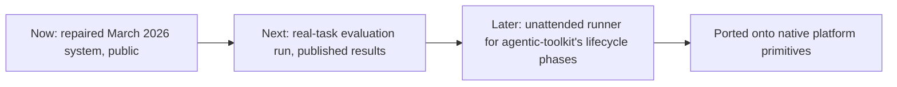

# Roadmap

Forward view of this repository: what is in flight, what comes next, and what was considered and parked. Single source of truth for "what's next". The March 2026 roadmap and its backlog analysis are kept as a historical record in [`1-discovery/2026-03-15-roadmap.md`](1-discovery/2026-03-15-roadmap.md).

Direction: publish the March 2026 system repaired, not extended; then treat the next chapter as an experiment on real tasks; then converge with the maintained tools instead of growing a parallel framework. The release shape is decided ([ADR 0007](6-adrs/0007-merge-reference-design-and-publish.md)). The steps after it are **proposed** and wait for the maintainer's confirmation.

## Now

Public release of the repaired March 2026 system.

| Item | State |
|---|---|
| Reference design merged under `blueprint/`, marked historical | Done on the release branch |
| Synthetic outputs removed from the tree, lifecycle records sanitized | Done on the release branch |
| Regression from `4d3ab9b` fixed; CI with a `required` gate; Dependabot | Done on the release branch |
| Safe defaults: no owner board IDs, `dontAsk` allowlist with deny rules, running-safely guide | Done on the release branch |
| README, architecture, methodology, case studies, ADR 0007, community health files | Done on the release branch |
| Privacy review of the GitHub record | Done: a November 2026 scan covered all 296 issues, 68 pull requests and 675 issue comments. Its two findings, a host-project mention in one comment on issue 54 and local paths in one comment on issue 336, were fixed. Closed issues keep their March titles as history. |
| Merge to `main`, branch protection with `required`, visibility change | Maintainer gates, not started |

## Next

**Proposed:** run the workflow on the [real-task backlog](3-plans/2026-11-20-real-task-backlog-plan.md) as a measured experiment and publish the results.

- 19 bounded tasks: 15 on this repository, 4 on two public tools the workflow did not write.
- Each task has deterministic acceptance tests, a risk tier that decides its human gates, and planned probes for a merge conflict, an interrupted run, interactive approval, fix-cycle exhaustion and planted defects.
- Results are reported per track and tier with their scope line, never pooled with the March 2026 synthetic metrics.
- Open before it can start: budget, where the external-repository track runs, the cross-family reviewer, and whether to drop the items the release already delivered (A01, and parts of A02 and A03).

## Later

**Proposed:** converge with [agentic-toolkit](https://github.com/carlosboeing/agentic-toolkit) so this workflow becomes the unattended runner for the toolkit's lifecycle phases, with [crossrev](https://github.com/carlosboeing/crossrev) as its review gate, instead of a parallel framework.

- Port the runner onto native primitives: worktree-isolated subagents, a script-held or Agent SDK workflow for wave scheduling, per-call model and effort, native OpenTelemetry metrics, GitHub sub-issues and dependencies.
- Keep what the platforms do not provide: durable records with recorded authority, risk-tiered gates tied to reversibility, merge ordering, measured verification, retrospectives with an adoption tracker.
- Trigger: results from the real-task evaluation.

## Parked

- **Declined (proposed):** a generic local project-management tool, meaning multi-tracker adapters, a local-first tracker and a dashboard as a product. The thesis is the engineering system around coding agents, not a PM product; the work raised the fix-cycle rate to 67 percent on the service build, and GitHub now provides native sub-issues and dependencies. Rationale: [architecture](architecture.md#pm-abstraction-and-the-runtime-service).
- **Deferred (proposed):** the runtime service as a local durable event log and telemetry store. Trigger: the evaluation run shows it needs queryable cross-run data. Until then the service stays in the tree as an experimental optional backend, with GitHub as the default path.
- **Deferred:** plugin packaging (issue #112), VCS and documentation abstraction layers (#207, #208), a configurable taxonomy (#110) and multi-tracker adapters (#113). Abstraction work without a consumer in the evaluation run.
- **Deferred:** domain profiles (#114), specialist agents (#115), multi-repository orchestration (#117), learning across projects (#118) and an adversarial deliberation agent (#148). Trigger: evaluation results.
- **Deferred:** CLI script redesign (#289) and telemetry diagrams (#166). Lower value than the evaluation items.
- **Superseded:** "run on real software" (#108) by the [real-task backlog](3-plans/2026-11-20-real-task-backlog-plan.md); retro rework (#107) by item A03; universal worktree isolation including the orchestrator (#149) by A06; rich agent metrics (#282) by A12; server auto-start (#363) by A14; local PM storage (#283) by the runtime service (#116).

## Recently shipped

- 2026-11-21: public release preparation on the release branch, see the [CHANGELOG](CHANGELOG.md) and [ADR 0007](6-adrs/0007-merge-reference-design-and-publish.md).
- 2026-03-24: GitHub-to-SQLite pull sync (backlog item 364), the last March 2026 backlog item. Earlier items are in the [CHANGELOG](CHANGELOG.md).
