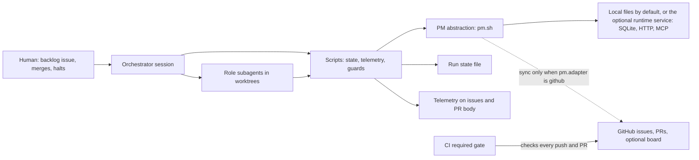

# Architecture of the agentic SDLC workflow

This document describes the system as built in March 2026 and repaired in November 2026, where the line between deterministic code and model judgment sits, how autonomy and halts work, and what the November 2026 platforms change. For the failures that shaped it, see the [case studies](case-studies.md). For the reference design written before it, see [`blueprint/`](../blueprint/README.md).

## System at a glance

The workflow runs inside Claude Code. One orchestrator session follows a long prompt, dispatches role subagents through the Agent tool, and calls shell and Python scripts for everything that can be computed. GitHub holds the code and the pull requests. Work items are local files by default, the optional runtime service's SQLite database when `pm.adapter` is `server`, or local files mirrored to GitHub issues when it is `github`.

## Components

| Component | Where | What it does | Status |
|---|---|---|---|
| Orchestrator | [`.claude/agents/orchestrator.md`](../.claude/agents/orchestrator.md) (roughly 670 lines) | Runs Phases 0 to 6, dispatches subagents, owns GitHub state and telemetry. Never writes code, designs, plans or reviews. | Built; control flow is prompt-driven |
| Role agents | [`.claude/agents/`](../.claude/agents/) | Designer, planner, builder, reviewer, retro. Each file lists what the role must not do. Builder variants for Haiku, Sonnet and Opus differ only in the `model` field. The reviewer has no `Write` or `Edit` tool (`disallowedTools`). | Built |
| Operating brief | [`CLAUDE.md`](../CLAUDE.md) (roughly 850 lines) | Conventions every agent loads: branches, labels, hierarchy, dispatch protocol, telemetry rules, lessons | Built; longer than current guidance |
| Work-item scripts | [`scripts/item-*.sh`](../scripts/) | The only way agents touch work items: create, get, list, comment, start, review, close, telemetry | Built, tested |
| PM abstraction | [`scripts/lib/pm.sh`](../scripts/lib/pm.sh) and `scripts/lib/adapters/pm/` | One interface with adapters for local files, the runtime service and GitHub. `pm.adapter` selects them; the shipped default writes local files only. With `github`, writes go to the local files first, then to GitHub without blocking. | Built, tested |
| Run state | [`scripts/state.sh`](../scripts/state.sh), [`orchestrator-state.v1.json`](../scripts/schemas/orchestrator-state.v1.json) | JSON state file per run with an append-only `dispatches[]` log, phase status, epic base commits and pricing | Built, tested; `reconstruct` is a stub |
| Telemetry | [`scripts/lib/compute-dispatches.py`](../scripts/lib/compute-dispatches.py), [`scripts/templates/telemetry.md`](../scripts/templates/telemetry.md) | Per-dispatch breakdown, phase summary, wall-clock, critical path, fix-cycle rate, orchestrator overhead and a Mermaid Gantt chart | Built, 252 tests |
| Board tools | [`reconcile-board.sh`](../scripts/reconcile-board.sh), [`batch-set-status.sh`](../scripts/batch-set-status.sh), [`check-board-drift.sh`](../scripts/check-board-drift.sh) | Compute expected board status from the state file and fix differences. Skipped when no board is configured. | Built, tested |
| Guards | [`check-retro-scope.sh`](../scripts/check-retro-scope.sh), [`ci.yml`](../.github/workflows/ci.yml) | Fail retro commits that touch code; server, telemetry and shell suites behind one `required` gate | Built November 2026 |
| Runtime service | [`server/`](../server/) | Bun, Hono HTTP API, Drizzle and SQLite, an MCP stdio server with 13 tools, a React dashboard, a sync queue with retry and dead-letter handling, and a pull sync from GitHub | Experimental, optional; started by hand |
| Permissions | [`.claude/settings.json`](../.claude/settings.json) | An allowlist shaped for `--permission-mode dontAsk`, plus deny rules for `gh pr merge`, pushes to `main`, force pushes, remote branch deletion, the post-merge cleanup script, hard resets, repository deletion and secret reads | Built November 2026; a filter, not an isolation boundary |
| Legacy CLI path | `scripts/dispatch-workflow.sh`, `scripts/dispatch-story.sh` | The first version's terminal dispatch, before the integration-branch model | Historical |
| Cost budget | `scripts/lib/cost-budget.sh` | A budget check library, sourced only by its test | Not wired in; nothing caps spend, and the shipped configs no longer list `maxCostPerRun` |

## Lifecycle

One run carries one backlog item. Everything happens on an integration branch `backlog/<N>-<slug>`, and one pull request goes to `main`.

| Phase | What happens | Who acts | Output |
|---|---|---|---|
| 0. Setup | Parse `Blocked by` and halt on an open dependency, create the integration branch, initialize the state file and fetch prices | Orchestrator, `state.sh` | Branch, state file |
| 1. Design | Designer compares approaches, checks platform facts against current docs, opens a design PR into the integration branch | Designer; human merges in interactive mode | Design document |
| 2. Plan | Planner writes the plan, epic and story issues with difficulty labels and dependencies, a Mermaid dependency graph; the orchestrator creates all epic and story branches from one recorded base commit | Planner, orchestrator | Plan, issues, branches |
| 3. Implementation | Per wave: parallel builders in worktrees, reviewers for REVIEW-tier stories, at most two fix cycles, merges into epic branches with `--no-ff` | Builders, reviewers, orchestrator | Story commits, review findings |
| 4. Backlog PR | Merge epics into the integration branch, open one PR to `main` with `Closes` for open issues only, reconcile the board | Orchestrator, scripts | Backlog PR |
| 5. Review and retro | PR review and retrospective in parallel; since November 2026 the retro scope guard and the full test suite run afterwards; documentation propagation | Reviewer, retro, orchestrator, guard | Findings, retro, CHANGELOG |
| 6. Telemetry | Compute and post the lifecycle telemetry on the backlog issue and in the PR body | `compute-dispatches.py`, `item-telemetry.sh` | Telemetry, Gantt chart |
| After merge | A human squash-merges, then runs `cleanup-post-merge.sh <N>`, which removes the item's merged branches, clean worktrees and run state directory, and keeps unmerged branches and dirty worktrees | Human | Clean repository |

Work items have exactly three levels: backlog item, epic, story, linked as GitHub sub-issues. A feature too large for three levels becomes several backlog items.

## Deterministic and probabilistic boundary

The rule in `CLAUDE.md` is "Determinism First": when a value can be computed from recorded data, compute it. It came from a run that reported the sum of sequential durations as wall-clock ([case study 5](case-studies.md#5-a-wall-clock-bug-that-produced-the-determinism-first-rule)). The boundary is applied to computation, not to control flow.

| Computed by tested code | Judged by models | Sequenced by the prompt (model instruction-following) |
|---|---|---|
| Wall-clock and critical path from dispatch start times | Design approaches and trade-offs | Phase order and phase skipping |
| Tokens, estimated cost, fix-cycle rate, orchestrator overhead | Decomposition into epics and stories, difficulty labels | Wave grouping from the plan's dependency graph |
| Expected board status and reconciliation | Code and tests for each story | When to dispatch, re-dispatch or halt |
| State file updates against a JSON schema | Review findings, severity and verdict | Auto-merging design and plan PRs in autonomous mode |
| Retro scope check, CI test gates | Retrospective synthesis and convention proposals | Calling each script at the right moment |

The third column is the main architectural weakness: a script cannot test it, and its reliability depends on context budget and instruction-following. Moving Phase 3 into a tested scheduling script is item A09 of the [real-task backlog](3-plans/2026-11-20-real-task-backlog-plan.md).

## Role tool restrictions

Since November 2026 the reviewer's frontmatter sets `disallowedTools: Write, Edit, NotebookEdit`, so it cannot edit files through those tools and reports lesson candidates in its findings instead. It keeps `Bash` because it runs the tests, so a shell command could still write a file: the restriction narrows the boundary rather than sealing it. The retro agent keeps `Write`, because writing the retrospective, lessons and convention proposals is its job. Its boundary is the retro scope guard: `scripts/check-retro-scope.sh`, run by the orchestrator after the retro and by CI on every pull request, fails any retro commit (`docs(retro)` or `docs(conventions)`) that touches a path outside `docs/`, `CLAUDE.md` and `.claude/agents/`.

## Isolation

- **Worktrees.** In autonomous mode every Agent dispatch uses `isolation: "worktree"`, so no two agents share a working tree.
- **Recorded base.** All story branches of an epic are created up front from one commit recorded in the state file, so a builder cannot start from a sibling's work.
- **Cleanup.** Worktree debris is removed before merges and before fix cycles.
- **Gap.** The orchestrator itself runs in the main checkout (issue #149).

Each rule cites the run that produced it ([case study 3](case-studies.md#3-parallel-builders-collided-then-isolation-tightened-in-four-steps)).

## State and telemetry

- **State.** `.agentic-workflow/runs/<backlog>/orchestrator.json` holds session data, prices, phases, epic base commits and the dispatch log. Issue comments act as a write-ahead log: a restart skips stories that already have a "Ready for Review" comment. Full reconstruction from GitHub is not implemented.
- **Telemetry.** The Agent tool returns duration, total tokens and tool uses per dispatch. The orchestrator records them, including for failed and resumed dispatches, and the scripts post per-story, per-epic and per-backlog tables. The backlog PR body is the single place for a run's full telemetry.
- **Cost.** Estimated API-equivalent value: tokens times a blended 75/25 input-output rate from fetched prices. Prompt caching and the orchestrator's own tokens are not measured.
- **Retention.** Post-merge cleanup deletes the state directory, so the issue and PR comments are the only lasting record of a run.

## PM abstraction and the runtime service

Agents call `scripts/item-*.sh`, never `gh` directly. The scripts call `pm_*` functions in `pm.sh`, which load an adapter:

| `pm.adapter` | Store | GitHub writes |
|---|---|---|
| `null` (shipped default) | Local files under `workflowDir` (`.workflow/`) | None |
| `server` | The runtime service's SQLite database through its HTTP API while it runs; the local files when it is down (with a warning) | None; the service reads issues from `github.repo` on first start and on a sync request |
| `github` | The local files, then GitHub issues, comments, labels and sub-issue links without blocking; issue creation waits for GitHub to get the number | Yes; board status too when the board fields are set, otherwise board operations skip with a notice |

Whatever the adapter, a run pushes branches and creates, comments on and edits pull requests with the user's `gh` credentials.

The runtime service started as a durable store for work items and grew into a dashboard, a document viewer with comments and an MCP server, so agents can use MCP tools instead of shell scripts. It is labelled experimental and optional: it must be started by hand, its MCP server predates the 2026-07-28 MCP specification, and GitHub now provides native sub-issues and dependencies that cover the hierarchy it models. The ROADMAP parks a narrower role for it, a local event log and telemetry store.

## Autonomy model and halt conditions

The word "autonomous" in the start prompt switches modes. Earlier configs listed `autoMergeDesignPR`, `autoMergePlanPR`, `skipRetro`, `maxParallelBuilders` and `maxCostPerRun`; no script or prompt read the first four and no workflow step calls the budget check, so the shipped configs dropped them in November 2026.

| Mode | What runs without a human | Human gates |
|---|---|---|
| Interactive | Building, review and telemetry after the plan is merged | Answer the designer's and planner's questions, merge the design and plan PRs, every gate below |
| Autonomous | Everything from Phase 0 to a reviewed backlog PR with telemetry, including merging design and plan PRs into the integration branch, creating and deleting branches, and every issue and board update | Every gate below |

Halt conditions are declared in the orchestrator prompt in advance, not left to the model's judgment of the moment. They are still recognized by the model, not enforced by code.

| Condition | Response |
|---|---|
| An open `Blocked by` dependency | Comment on the issue and halt |
| Designer or planner fails twice | Abort the run |
| A builder fails twice | Comment and halt |
| A third fix cycle would be needed | Request human intervention and halt |
| Merge conflict between stories | `git merge --abort`, report, halt; never resolve automatically |
| A design or plan auto-merge fails | Comment and halt; never force-merge |
| Retro scope guard or full test suite fails after the retro | Halt before documentation propagation (since November 2026) |
| Backlog PR ready | Leave open; a human reviews and squash-merges |

Deny rules in `.claude/settings.json` refuse `gh pr merge` and the usual forms of a push to `main` (`git push <remote> main`, `git push <remote> <ref>:main`) in every agent session, subagents included, and in every permission mode. The orchestrator therefore merges design and plan PRs into the integration branch with `git merge` and a push. Deny rules match the command text, so a differently written command (`git -C . push origin main`) or a script that pushes is not caught; branch protection on `main`, a repository setting this repository cannot ship, is the boundary that holds against those. A PreToolUse check that inspects the target branch is part of backlog item A02.

## Known platform limitations, then and now

`CLAUDE.md` lists Claude Code limitations observed in March 2026. Rechecked against current documentation on 2026-11-20 ([state-of-practice research](1-discovery/2026-11-20-state-of-practice-research.md)), three of those five no longer hold and two could not be confirmed either way. Other March assumptions changed too.

| March 2026 limitation | Workaround built | November 2026 status |
|---|---|---|
| The Agent tool had no `model` parameter | Four builder files that differ only in `model` | Per-call model alias, plus an `effort` setting per subagent. The variant files are now optional. [Subagents](https://code.claude.com/docs/en/sub-agents) |
| Agent files created mid-session were not discovered | All agent files must exist at session start | `.claude/agents/` is watched and changes apply without a restart. [Subagents](https://code.claude.com/docs/en/sub-agents) |
| Subagents could not start subagents | The orchestrator dispatches every reviewer; the builder-dispatches-reviewer design was dropped | Nesting up to three levels by default, configurable. [Subagents](https://code.claude.com/docs/en/sub-agents) |
| PreToolUse `updatedInput` crashed on the Agent tool | No rewriting of dispatch inputs | Not confirmed; the [hooks reference](https://code.claude.com/docs/en/hooks) does not cover it |
| `claude -p` refused to start inside a session | Agent tool dispatch only; CLI scripts for terminal use | Not re-verified. Script-held orchestration now exists as [dynamic workflows](https://code.claude.com/docs/en/workflows) and in the [Agent SDK](https://code.claude.com/docs/en/agent-sdk/overview) |
| The subagent tool was named `Task` | Logging hook matched `Task` | Renamed `Agent`; the matcher was fixed to `Agent\|Task` in November 2026 |
| Unattended runs needed `--dangerously-skip-permissions` | Bypass mode as the documented path | `auto` and `dontAsk` modes; bypass only in isolated containers or VMs; `claude -p` starts in Manual mode. This repository now ships a `dontAsk` allowlist. [Permission modes](https://code.claude.com/docs/en/permission-modes) |
| No native cost metrics | Tokens times a blended rate from scraped prices | Native OpenTelemetry cost and token metrics, including cache tokens. [Monitoring](https://code.claude.com/docs/en/monitoring-usage) |
| No native wave execution or worktree management | Prompt-driven waves, custom cleanup | Dynamic workflows, `/batch`, `isolation: worktree` with base-ref selection and automatic sweeps. [Worktrees](https://code.claude.com/docs/en/worktrees) |
| GitHub hierarchy needed labels and a `Blocked by` body line | Label conventions and a parsed body line | Native sub-issues, issue types and [issue dependencies](https://github.blog/changelog/2025-08-21-dependencies-on-issues/) |

## November 2026 revision

Most of what the workflow built by hand in March is now a platform feature. What remains distinctive is the operating model: durable records at each handoff, deterministic code around probabilistic work, human gates at irreversible steps, measured verification, and retrospectives that change the system. The assessment below comes from the mapping section of the [state-of-practice research](1-discovery/2026-11-20-state-of-practice-research.md#mapping-to-the-blueprint-and-workflow).

### Holds

| Mechanism | Why it still matters |
|---|---|
| Durable lifecycle records as the handoff between phases | Spec, plan and tasks are now mainstream; recorded authority and gates are not |
| Determinism-first boundary for computation | Matches harness engineering's computational sensors |
| Human merge authority and pre-declared halts | Matches risk-tiered oversight; the opposite of a dark factory |
| Review tiers and bounded fix loops | Need explicit stop criteria and evidence for blocking findings |
| Base-commit recording and merge ordering | Platforms isolate workers; they do not order merges or resolve conflicts |
| Retrospectives with a human-curated adoption tracker | The feedback flywheel; most published reports are anecdotal |
| Backend-agnostic PM interface | Vendors integrate their own trackers first |

### Now a platform feature

| Built by hand in March 2026 | Platform equivalent in November 2026 |
|---|---|
| Worktree creation and cleanup | `isolation: worktree`, `worktree.baseRef`, `.worktreeinclude`, automatic sweeps |
| Wave scheduling in the prompt | Dynamic workflows (script-held, resumable), `/batch`, Kiro wave execution |
| Builder variant files for routing | Per-call model and effort |
| Token-based cost estimates | Native OpenTelemetry cost and token metrics |
| Single-model story review | Built-in `/code-review` and multi-agent review with reproduced findings |
| Hierarchy labels and `Blocked by` parsing | GitHub sub-issues and native dependencies |

### Revise

| March 2026 approach | Revision | Real-task backlog item |
|---|---|---|
| Control flow in a prompt of roughly 670 lines | Phase 3 in a tested script or Agent SDK workflow with schema-checked agent returns | A09 |
| One "autonomous" keyword | Risk tiers from changed paths and labels, with human gates on irreversible actions in every tier | A13 |
| Role boundaries as instructions | Per-agent tools, `disallowedTools` and `permissionMode`. Started in November 2026: the reviewer has no edit tools | A02 |
| A `CLAUDE.md` of roughly 850 lines | Under 200 lines plus path-scoped rules and skills | A11 |
| Estimated cost, no budget enforcement | Native telemetry with GenAI attribute names, a budget halt | A12 |
| Routing by model only | Routing on model and effort pairs, recorded per dispatch | A05 |
| Raw run state deleted after merge | Run record bundles kept so telemetry can be recomputed | A08 |
| Retro proposals without measurement | Each proposal carries an evidence link and a before-and-after metric | A03 |
| Runtime service as a PM product | A local event log and telemetry store, checked against MCP 2026-07-28, if the evaluation shows a need | A14, Deferred in the ROADMAP |

The March implementation receives the fixes a safe first run needs. Further change goes through the real-task evaluation described in the [ROADMAP](ROADMAP.md), and the maintained form of the method lives in [agentic-toolkit](https://github.com/carlosboeing/agentic-toolkit) and [crossrev](https://github.com/carlosboeing/crossrev).
