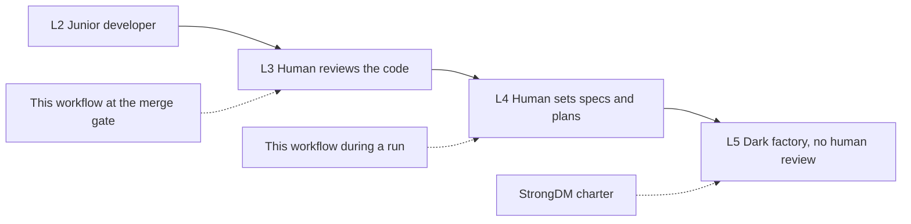

# Methodology: classical practice applied to coding agents

This page maps each practice the workflow uses to its classical engineering lineage and to the term the field uses for it in November 2026, then answers whether the system is an "AI software factory". The full evidence, with file references for every row, is in the [methodology mapping research](1-discovery/2026-11-21-methodology-mapping-research.md); platform facts come from the [state-of-practice research](1-discovery/2026-11-20-state-of-practice-research.md).

## Summary

- **Almost every practice is classical engineering applied to coding agents:** design documents and ADRs, a three-level backlog, critical-path scheduling, integration branches, inspection-style review with separation of duties, kaizen and blameless postmortems, least privilege.
- **The 2026 names for the same ideas** are agentic engineering for the practice as a whole [11], harness engineering for the scripts-compute, models-judge boundary [20], context engineering for role-scoped context [19], spec-driven development for design, plan and tasks [16], orchestrator-workers and evaluator-optimizer for dispatch and review [14], risk-tiered oversight and human-on-the-loop for the gates [24][22], and the feedback flywheel for retrospectives [27].
- **It is a factory-style pipeline with human merge authority, not a dark factory.** It has stations, gates and line telemetry; it keeps a human accountable for every merge to `main`.
- **What is table stakes and what is not.** Subagents, worktree-isolated waves, spec-plan-tasks, model routing and automated review now ship in products. What remains less common is the combination: authority recorded at gates tied to reversibility, verification measured with stated scope, and retrospectives whose proposals are tracked to adoption or rejection.

## How to read this page

- **Status** says how far the workflow implements a practice: Built, Partial, Designed (in the [reference design](../blueprint/README.md) only), Successor (carried forward in [agentic-toolkit](https://github.com/carlosboeing/agentic-toolkit) or [crossrev](https://github.com/carlosboeing/crossrev)), Proposed, or Gap.
- **Sources** in square brackets use the numbering of the research record and are listed at the end. "Inference" marks the author's reading of the evidence.
- **Dates.** Practices are described as built in March 2026; the November 2026 column notes what the release preparation changed.

## 1. Practices, lineage and current terms

### Lifecycle and planning

| ID | Practice in the workflow | Classical lineage | November 2026 term | Status and fit |
|---|---|---|---|---|
| L1 | Phase-gated lifecycle: setup, design, plan, implementation waves, backlog PR, review with retro, telemetry | Phased lifecycle [69], stage gates | Spec-driven development [16][42][43]; prompt chaining with gates [14] | Built. The field cautions that heavy up-front specs can be "elaborate and opinionated" [17]. |
| L2 | Right-sized entry: skip design and plan when artifacts exist | Process tailoring | Radar caution on AI-driven documentation sprawl [29] | Built; the toolkit's "document test" is the successor |
| L4 | Design document with alternatives and a mandatory feasibility check against current docs | RFCs [70], design docs with alternatives [71] | Design phase of SDD [42]; sprint contract before building [51] | Built. The documentation check is an agent-specific addition: a model's knowledge of its own platform goes stale. |
| L5 | Numbered ADRs written by the planner | Nygard's ADRs [72] | Spec Kit constitution [43] | Built |
| L6 | Approval by merging a document PR | Peer review, docs as code | Phase review in Kiro [42], plan mode [47] | Built. In autonomous mode the merge is agent approval, not human approval (Inference). |
| L7 | Backlog item, epic, story as GitHub sub-issues | Scrum backlog [74], work breakdown | Native sub-issues [58] | Built |
| L8 | Machine-parsed dependencies and a dependency graph | Critical-path method [76], topological sort [77] | Wave execution [42][44] | Built; table stakes in 2026 |
| L9 | Difficulty labels separate from size labels | Relative estimation | Routing to smaller models [14] | Built; sizing feeds model choice and review depth, not velocity |
| L10 | Acceptance criteria as the binding contract | Design by contract [80] | Sprint contract [51] | Built; criteria are prose checklists, not machine-checked |
| L11 | Shadow-stack migration, namespaced extension points | Strangler fig [82], branch by abstraction [83], ports and adapters [84] | No AI-specific term | Built ([ADR 0004](6-adrs/0004-shadow-stack-migration.md)) |

### Execution

| ID | Practice in the workflow | Classical lineage | November 2026 term | Status and fit |
|---|---|---|---|---|
| E1 | Role specialization with written phase boundaries | Surgical team [86], chief programmer team [85] | Subagents with own tools and model [45] | Built. "Parallelism and specialization have to earn their coordination cost" [50]. |
| E2 | Orchestrator that never writes code | Chief programmer team [85] | Orchestrator-workers [14]; centralized coordination contains errors better [63] | Built. The plan lives in a prompt; the 2026 recommendation is a resumable script [44]. |
| E3 | Dependency waves with a parallelism cap of 3 | CPM [76], WIP limits [75], Little's law [79] | Concurrency limits in dynamic workflows [44] | Partial: the cap is enforced by the prompt |
| E4 | Worktree per dispatch, branches from one recorded base | Isolated workspaces | Native worktree isolation [46] | Built; the base-commit rule still matters |
| E5 | Integration branch per backlog item, one PR to `main` | Feature branching [87], git-flow [89] | Contrast: post-merge testing at very high merge rates [55] | Built. A run-length branch batches risk; [case study 2](case-studies.md#2-a-retrospective-commit-that-reverted-reviewed-code) landed there. |
| E6 | Model routing by difficulty | Tiered escalation, model cascades [91] | Routing [14], cascade and critique [57], effort as a second axis [45] | Built (static routing); the reference design's retry ladder is a cascade |
| E7 | State file with an append-only dispatch log, idempotent restart | Write-ahead logging [92], event sourcing [93] | Session as a durable event log [52], resumable workflows [44] | Partial: reconstruction from GitHub is a stub |
| E8 | PM abstraction with GitHub, local and server adapters | Ports and adapters [84] | MCP as the integration layer [59] | Built |

### Quality

| ID | Practice in the workflow | Classical lineage | November 2026 term | Status and fit |
|---|---|---|---|---|
| Q1 | Test-driven builders | Beck [94] | Red/green TDD [11]. TDD prompting alone raised regressions; test-impact context reduced them [66]. | Built. A TDD instruction alone is not a quality claim. |
| Q2 | Review tiers: skip per-story review for easy stories, always review the PR | Risk-based testing | Risk-tiered oversight [24] | Built; tiers follow difficulty and a label, not blast radius |
| Q3 | Severity-ranked findings with a verdict; reviewers must not edit | Fagan inspection [95] | LLM-as-judge [38], evaluator [14], reproduced-findings review [49] | Built |
| Q4 | At most two fix cycles, then a human | Rework limits with escalation | Evaluator-optimizer [14]; the Ralph loop is the unbounded variant [28] | Built; crossrev generalizes it |
| Q5 | Override of a verdict only with a committed, documented fix | Change-control waiver | No AI-specific term | Built |
| Q6 | Planted defects to force review paths | Defect seeding [97], mutation testing [96] | Mutation testing at Adopt [29], known-answer evals [39] | Built, small samples. Builders that follow criteria can remove a planted bug before review. |
| Q7 | Determinism-first boundary | Separation of mechanism and policy | Computational and inferential sensors [20] | Built for computation, not control flow |
| Q8 | Independent review passes | N-version programming [98], independent V&V | Self-preferential bias [50], cross-model review [65] | One experiment: re-review by the same agent did not overturn its wrong dismissals |
| Q9 | Cross-model reviewer and resolver loop | Inspection with author rework [95] | Cross-model review [65] | Successor (crossrev). Claim "a second strong reviewer", not "a different vendor is required". |
| Q11 | Continuous integration | Fowler [90] | Continuous AI beside CI, not instead [40] | Gap in March 2026; closed in November 2026 by CI with a `required` gate |

### Operations and learning

| ID | Practice in the workflow | Classical lineage | November 2026 term | Status and fit |
|---|---|---|---|---|
| O1 | Per-dispatch telemetry on issues and the PR body | DORA metrics [105][62] | Native OpenTelemetry metrics [48], GenAI agent spans [60] | Built; now platform-native |
| O2 | Estimated cost, kept secondary to tokens and duration | Unit cost per change | Cost per accepted change [61] | Partial: budget library not wired in |
| O3 | Gantt timeline, critical path, orchestrator overhead | Gantt charts, CPM [76] | Per-agent progress views [44] | Built; ahead of common practice (Inference) |
| O4 | Amdahl ceiling. Across the 14 analyzed runs, average speedup was 1.22x and the best was 1.39x; the 8 runs with parallel waves listed in the analysis average 1.29x. A 60 percent sequential model, assumed rather than measured, predicts about 1.36x for three-way parallelism | Amdahl's law [78] | Scaling studies of agent systems [63] | Built |
| O5 | Fix-cycle rate as the quality signal, split by workload | Change fail rate, rework rate [62] | First-pass acceptance [30], rework rate [61] | Built; measured before merge only |
| O6 | Hypotheses tested by telemetry and reverted | Evidence-based improvement [105] | Evals [39], re-test harness components on model change [51] | Built ([case study 1](case-studies.md#1-a-cost-saving-hypothesis-that-telemetry-disproved)) |
| O7 | One lesson file per finding, by feature and epic | After-action reviews | One memory file per agent to avoid overwrites [54], compounding [32] | Built |
| O8 | Evidence-only retrospective that proposes convention changes | Retrospectives [104], kaizen [101] | Feedback flywheel [27], compound engineering [32] | Built. An agent proposes and a human adopts, which is the flywheel, not a self-improving harness [26]. |
| O9 | Adoption tracker, including declined proposals | Kaizen records [101] | Bounded harness experiments [26] | Built; recurrence after adoption is not measured |
| O10 | Blameless lessons: causes and prevention, not people | Blameless postmortems [102][103] | "Change the harness that produced the artefact" [22] | Built |
| O11 | Long instruction files (a `CLAUDE.md` of roughly 850 lines) | Layered configuration | Progressive disclosure at Adopt, instruction bloat at Caution [29] | Behind current practice; the toolkit's short brief plus skills is the successor |

### Governance

| ID | Practice in the workflow | Classical lineage | November 2026 term | Status and fit |
|---|---|---|---|---|
| G1 | Human merge authority over every backlog PR | Four-eyes principle, separation of duties [100] | Human at the merge gate [7], hardest-to-reverse changes reserved for humans [24] | Built |
| G2 | Halt conditions declared in advance | Jidoka, stop the line [101]; fail-safe defaults [99] | Approver level of autonomy [31] | Built in the prompt, recognized by the model |
| G3 | Interactive and autonomous modes switched by one keyword | Levels of automation [106], SAE J3016 [107] | Autonomy levels [1], permission modes [47], risk tiers [24] | Partial; coarser than risk tiers |
| G4 | Least privilege and defense in depth | Saltzer and Schroeder [99], NIST AC-6 [100] | Agent sandboxing [29], containment first [53] | Designed in the reference design. In November 2026 the workflow gained a `dontAsk` allowlist with deny rules; per-role tool limits are still missing. |
| G5 | Builders never merge their own work; reviewers never edit | NIST AC-5 [100], independent inspection [95] | Self-preferential bias [50] | Built by instruction; it failed once ([case study 2](case-studies.md#2-a-retrospective-commit-that-reverted-reviewed-code)) |
| G7 | Audit trail and AI attribution in commits | Audit logs | Attribution builds trust [68] | Built |

## 2. Is this an "AI software factory"?

The phrase carries two meanings in 2026, and the sources split on one question: does a human review the code?

| Source | Definition | Humans review code? | Sense |
|---|---|---|---|
| Classical software factories (1960s to 1991) | Standardized process, reusable tools, division of labor, measurement [10][6] | Yes | Process |
| Shapiro, Level 5 (2026-01-23) | "A black box that turns specs into software", where humans are "neither needed nor welcome" [1] | No | Autonomy level |
| StrongDM software factory (2026-02-06) | Specs and scenarios drive agents; "Code must not be reviewed by humans" [3][4] | No | Autonomy level |
| Factory, vendor (2026) | A managed model for producing software, keeping existing approval and release controls [5][6] | Yes | Process |
| Firecrawl guide (2026-09-11) | The system around a coding agent: intake, isolation, tools, verification, merge gate [7] | Automated checks plus a human | Process |
| This workflow (March 2026) | A phase-gated pipeline of role agents around deterministic scripts | Agent review by tier, plus a human on every backlog PR | Process |

During a run the workflow behaves like Level 4 on Shapiro's ladder: a human sets the backlog item and is pulled in only at declared halts. At the merge it returns to Level 3, because a human reviews the result. It never reaches Level 5.

| Factory trait | Mechanism here |
|---|---|
| Sequenced stations | Phases 0 to 6 |
| Specialized stations with standard work | Role agents, templates and schemas |
| Work orders routed by type | Difficulty labels routed to models |
| Parallel lines with a WIP limit | Dependency waves with a cap of 3 |
| Isolated work cells | One worktree per dispatch |
| Inspection stations | Review tiers, PR review, bounded fix loops |
| Stop the line | Pre-declared halt conditions |
| Line telemetry | Tokens, durations, Gantt chart, critical path, fix-cycle rate |

Where it differs from the dark factory on purpose: a human reviews and merges every backlog PR; humans stay at irreversible or ambiguous points; reviewers are themselves measured (planted defects, a multi-pass experiment); telemetry is used to falsify the author's decisions rather than to maximize throughput; and every step leaves a record. Where it fell short of a factory in March 2026: no automated final inspection (no CI, now added), station boundaries enforced by instructions, unattended runs without containment (now a documented container path), mostly synthetic material, and raw run records deleted after each merge.

**Answer.** In the process sense used by the software-factory literature, yes: it is a factory-style pipeline. In the autonomy sense that dominates 2026 usage, no: a dark factory removes human code review, and this workflow keeps a human accountable for every merge. If "factory" is used at all, use "factory-style pipeline with human merge authority, not a dark factory".

## 3. Table stakes and what remains distinctive

| Table stakes in November 2026 | Shipped by |
|---|---|
| Specialized subagents with their own context, tools and model | Claude Code, Codex, Antigravity [45] |
| Parallel agents in git worktrees | Claude Code, Cursor, Codex [46] |
| Dependency-aware wave execution | Kiro, Claude Code dynamic workflows [42][44] |
| Spec, plan and tasks as durable Markdown | Spec Kit, Kiro, OpenSpec [43][42] |
| Model routing across tiers | Copilot Fusion, Antigravity [57] |
| Automated multi-agent code review | Claude Code ultrareview, Copilot code review [49] |
| Cost and token telemetry | Claude Code OpenTelemetry metrics [48] |

| Still a less common combination (Inference: no single product found combines these) | Why it matters |
|---|---|
| Authority and review recorded in lifecycle records, with human gates tied to reversibility | Platforms log sessions, not which human authorized which transition; human-in-the-loop theater is a named anti-pattern [25] |
| Verification measured with stated scope: planted defects, multi-pass review, fix-cycle rates split by workload | Guidance exists [20][39]; published end-to-end practice with numbers is rare |
| Hypotheses falsified by the author's own telemetry and reverted | The opposite of throughput marketing [61] |
| Retrospectives with an adoption tracker that records declined changes | Self-improving harnesses are at Trial and most reports are anecdotal [26] |
| A public failure record: incidents, reversions and design evolution in Git | Rare in public repositories |

## 4. Recommended vocabulary

These terms each have an established source, so a reader can look them up.

| Term | Meaning in this repository |
|---|---|
| Agentic engineering | Building software with coding agents while humans keep engineering discipline: specs, review, verification [11] |
| Agentic SDLC | The full lifecycle, from backlog item to merged change and retrospective, run by agents in defined roles |
| Harness | Everything around the model: instructions, tools, scripts, guides and sensors [20] |
| Context engineering | Choosing what each agent sees: role-scoped documents, lessons and just-in-time lookups [19] |
| Spec-driven development | Durable requirements, design and plan written before code and kept for later change [16] |
| Orchestrator-workers | One coordinator holds the plan and state; workers do bounded tasks and report back [14] |
| Dependency waves | Independent tasks run in parallel batches computed from the dependency graph |
| Worktree isolation | Each worker writes in its own git worktree, branched from one recorded base commit |
| Determinism-first boundary | Scripts compute state, time, cost and routing; models do design, content and judgment |
| Guides and sensors | Feedforward instructions that steer agents, and feedback checks, computational or inferential, that catch errors [20] |
| Risk-tiered review | Review depth matched to what a change can break and how hard it is to undo [24] |
| Bounded fix loop | An evaluator-optimizer loop with a cycle limit and a human exit [14] |
| Human-on-the-loop, with merge authority | Humans steer the harness and own irreversible actions such as merging to `main` [22] |
| Halt conditions | Situations declared in advance where the run stops and asks a human, as when an operator stops the line [101] |
| Feedback flywheel | Retrospectives turn evidence into proposed convention changes that a human adopts or declines [27] |

Avoid "fully autonomous", "zero human intervention" and "merge-ready", which the recorded runs contradict; an unqualified "AI software factory" or "dark factory"; and "self-improving" or "self-healing", since here an agent proposes, a human adopts, and recurrence was not measured. Use "retrospective-driven continuous improvement" instead.

The word "workflow" now has three other meanings: Anthropic's predefined code paths as opposed to agents [14], GitHub Agentic Workflows [41], and Claude Code dynamic workflows [44]. This repository's name uses the older SDLC sense.

## Sources

Numbers follow the [methodology mapping research](1-discovery/2026-11-21-methodology-mapping-research.md#sources), which also gives each source's evidence label (verified, secondary or bibliographic).

- [1] Shapiro, "The Five Levels: from Spicy Autocomplete to the Dark Factory". https://www.danshapiro.com/blog/2026/01/the-five-levels-from-spicy-autocomplete-to-the-software-factory/. 2026-01-23.
- [3] McCarthy, "Software Factories And The Agentic Moment", StrongDM AI. https://factory.strongdm.ai. 2026-02-06.
- [4] Willison, "How StrongDM's AI team build serious software without even looking at the code". https://simonwillison.net/2026/Feb/7/software-factory/. 2026-02-07.
- [5] Grinberg and Reyes, "Factory 2.0: From coding agents to software factories", Factory. https://factory.com/news/software-factory. 2026-06-15.
- [6] "What is a software factory?", Factory. https://factory.com/articles/what-is-a-software-factory. 2026-07-18.
- [7] "How to Build an AI Software Factory: Agents That Open, Review, and Merge PRs", Firecrawl. https://www.firecrawl.dev/blog/ai-software-factory. 2026-09-11.
- [10] Cusumano, "Japan's Software Factories: A Challenge to U.S. Management", Oxford University Press. https://academic.oup.com/book/52424. 1991-03-07.
- [11] Willison, "What is agentic engineering?", Agentic Engineering Patterns. https://simonwillison.net/guides/agentic-engineering-patterns/what-is-agentic-engineering/. Guide started 2026-02-23 (accessed 2026-11-21).
- [14] Erik S. and Zhang, "Building effective agents", Anthropic. https://www.anthropic.com/engineering/building-effective-agents. 2024-12-19.
- [16] Böckeler, "Understanding Spec-Driven-Development: Kiro, spec-kit, and Tessl", martinfowler.com. https://www.martinfowler.com/articles/exploring-gen-ai/sdd-3-tools.html. 2025-10-15.
- [17] "Spec-driven development", Thoughtworks Technology Radar (Assess). https://www.thoughtworks.com/radar/techniques/spec-driven-development. 2025-11-05.
- [19] "Effective context engineering for AI agents", Anthropic Engineering. https://www.anthropic.com/engineering/effective-context-engineering-for-ai-agents. 2025-09-29.
- [20] Böckeler, "Harness engineering for coding agent users", martinfowler.com. https://martinfowler.com/articles/harness-engineering.html. 2026-04-02.
- [22] Morris, "Humans and Agents in Software Engineering Loops", martinfowler.com. https://www.martinfowler.com/articles/exploring-gen-ai/humans-and-agents.html. 2026-03-04.
- [24] "Risk-tiered human oversight", Thoughtworks Technology Radar (Trial). https://www.thoughtworks.com/radar/techniques/risk-tiered-human-oversight. 2026-11-04.
- [25] "Human-in-the-loop theater", Thoughtworks Technology Radar (Caution). https://www.thoughtworks.com/radar/techniques/human-in-the-loop-theater. November 2026.
- [26] "Self-improving harness", Thoughtworks Technology Radar (Trial). https://www.thoughtworks.com/radar/techniques/self-improving-harness. 2026-11-04.
- [27] "Feedback flywheel", Thoughtworks Technology Radar (Trial). https://www.thoughtworks.com/radar/techniques/feedback-flywheel. 2026 (read via search results).
- [28] "Ralph loop", Thoughtworks Technology Radar (Assess). https://www.thoughtworks.com/en-us/radar/techniques/ralph-loop. 2026-04-15.
- [29] Thoughtworks Technology Radar Vol. 35. https://www.thoughtworks.com/radar. November 2026.
- [30] "Coding throughput as a measure of productivity", Thoughtworks Technology Radar (Caution). https://www.thoughtworks.com/radar/techniques/coding-throughput-as-a-measure-of-productivity. April and November 2026.
- [31] Feng, McDonald and Zhang, "Levels of Autonomy for AI Agents". https://arxiv.org/abs/2506.12469. June 2025 (v2 July 2025; read via search results).
- [32] Shipper and Klaassen, "Compound Engineering: How Every Codes With Agents", Every. https://every.to/source-code/compound-engineering-how-every-codes-with-agents. 2025-12-11.
- [38] Zheng et al., "Judging LLM-as-a-Judge with MT-Bench and Chatbot Arena". https://arxiv.org/abs/2306.05685. 2023-06-09 (read via search results).
- [39] "Demystifying evals for AI agents", Anthropic Engineering. https://www.anthropic.com/engineering/demystifying-evals-for-ai-agents. 2026-01-09.
- [40] "Continuous AI", GitHub Next. https://githubnext.com/projects/continuous-ai/. June 2025.
- [41] "GitHub Agentic Workflows generally available", GitHub Changelog. https://github.blog/changelog/2026-10-28-github-agentic-workflows-generally-available. 2026-10-28.
- [42] Specs, Kiro docs. https://kiro.dev/docs/specs/. Updated 2026-11-12.
- [43] github/spec-kit repository. https://github.com/github/spec-kit. Accessed 2026-11-20 (read via search results).
- [44] Orchestrate subagents at scale with dynamic workflows, Claude Code docs. https://code.claude.com/docs/en/workflows. Accessed 2026-11-20.
- [45] Create custom subagents, Claude Code docs. https://code.claude.com/docs/en/sub-agents. Accessed 2026-11-20.
- [46] Run parallel sessions with worktrees, Claude Code docs. https://code.claude.com/docs/en/worktrees. Accessed 2026-11-20.
- [47] Permission modes, Claude Code docs. https://code.claude.com/docs/en/permission-modes. Accessed 2026-11-20.
- [48] Monitoring usage (OpenTelemetry), Claude Code docs. https://code.claude.com/docs/en/monitoring-usage. Accessed 2026-11-20.
- [49] Find bugs with ultrareview, Claude Code docs. https://code.claude.com/docs/en/ultrareview. Accessed 2026-11-20.
- [50] Shihipar and Bidasaria, "A harness for every task: dynamic workflows in Claude Code". https://claude.dev/blog/a-harness-for-every-task-dynamic-workflows-in-claude-code/. 2026-06-02.
- [51] Rajasekaran, "Harness design for long-running application development", Anthropic Engineering. https://www.anthropic.com/engineering/harness-design-long-running-apps. 2026-03-24.
- [52] Martin, Cemaj and Cohen, "Scaling Managed Agents: Decoupling the brain from the hands", Anthropic Engineering. https://www.anthropic.com/engineering/managed-agents. 2026-04-08.
- [53] McGuinness et al., "How we contain Claude across products", Anthropic Engineering. https://www.anthropic.com/engineering/how-we-contain-claude. 2026-05-25.
- [54] Martin, "The components of agent memory", Anthropic Engineering. https://www.anthropic.com/engineering/components-of-agent-memory. 2026-11-06.
- [55] "Redesigning source control at Anthropic", Anthropic Engineering. https://www.anthropic.com/engineering/redesigning-source-control. 2026-10-13.
- [57] "Route and orchestrate models with GitHub Copilot Fusion", GitHub Changelog. https://github.blog/changelog/2026-10-28-route-and-orchestrate-models-with-github-copilot-fusion. 2026-10-28.
- [58] "Evolving GitHub Issues and Projects", GitHub Changelog. https://github.blog/changelog/2025-04-09-evolving-github-issues-and-projects/. 2025-04-09 (read via search results).
- [59] Model Context Protocol specification (2026-07-28). https://modelcontextprotocol.io/specification/latest. Accessed 2026-11-20.
- [60] GenAI agent spans, OpenTelemetry semantic-conventions-genai. https://github.com/open-telemetry/semantic-conventions-genai/blob/main/docs/gen-ai/gen-ai-agent-spans.md. Accessed 2026-11-20.
- [61] Conaway, "Finding balance in the era of tokenmaxxing", DORA. https://dora.dev/insights/finding-balance-in-the-era-of-tokenmaxxing/. 2026-06-02.
- [62] DORA's software delivery metrics. https://dora.dev/guides/dora-metrics/. Updated 2026-01-05.
- [63] Kim et al., "Towards a Science of Scaling Agent Systems". https://arxiv.org/abs/2512.08296. 2025-12-09.
- [65] Song, "When Does a Second Model Help? Cross-Model Review in LLM Verification". https://arxiv.org/abs/2610.01471. 2026-10-01.
- [66] Alonso, Yovine and Braberman, "TDAD: Test-Driven Agentic Development". https://arxiv.org/abs/2603.17973. 2026-03-18.
- [68] "The results of the 2026 Developer Survey are here!", Stack Overflow. https://stackoverflow.blog/2026/10/06/the-results-of-the-2026-developer-survey-are-here/. 2026-10-06.
- [69] Royce, "Managing the Development of Large Software Systems", Proceedings of IEEE WESCON. 1970.
- [70] Crocker, RFC 1, "Host Software". https://www.rfc-editor.org/rfc/rfc1. 1969-04-07.
- [71] Ubl, "Design Docs at Google". https://www.industrialempathy.com/posts/design-docs-at-google/. 2020-07-06.
- [72] Nygard, "Documenting Architecture Decisions". https://www.cognitect.com/blog/2011/11/15/documenting-architecture-decisions. 2011-11-15.
- [74] Schwaber and Sutherland, "The Scrum Guide". https://scrumguides.org/scrum-guide.html. November 2020.
- [75] Anderson, "Kanban: Successful Evolutionary Change for Your Technology Business", Blue Hole Press. 2010.
- [76] Kelley and Walker, "Critical-path planning and scheduling", Eastern Joint Computer Conference. https://doi.org/10.1145/1460299.1460318. 1959.
- [77] Kahn, "Topological sorting of large networks", Communications of the ACM. https://doi.org/10.1145/368996.369025. 1962-11.
- [78] Amdahl, "Validity of the single processor approach to achieving large scale computing capabilities", AFIPS Spring Joint Computer Conference. https://doi.org/10.1145/1465482.1465560. 1967.
- [79] Little, "A Proof for the Queuing Formula: L = λW", Operations Research. https://doi.org/10.1287/opre.9.3.383. 1961-06.
- [80] Meyer, "Applying 'design by contract'", IEEE Computer. https://doi.org/10.1109/2.161279. 1992-10.
- [82] Fowler, "StranglerFigApplication". https://martinfowler.com/bliki/StranglerFigApplication.html. 2004.
- [83] Fowler, "BranchByAbstraction". https://martinfowler.com/bliki/BranchByAbstraction.html. 2014.
- [84] Cockburn, "Hexagonal architecture". https://alistair.cockburn.us/hexagonal-architecture/. 2005.
- [85] Baker, "Chief programmer team management of production programming", IBM Systems Journal. https://doi.org/10.1147/sj.111.0056. 1972.
- [86] Brooks, "The Mythical Man-Month", Addison-Wesley. 1975.
- [87] Fowler, "Patterns for Managing Source Code Branches". https://martinfowler.com/articles/branching-patterns.html. 2020-05-28.
- [89] Driessen, "A successful Git branching model". https://nvie.com/posts/a-successful-git-branching-model/. 2010.
- [90] Fowler, "Continuous Integration". https://martinfowler.com/articles/continuousIntegration.html. 2006 (revised 2024).
- [91] Chen, Zaharia and Zou, "FrugalGPT: How to Use Large Language Models While Reducing Cost and Improving Performance". https://arxiv.org/abs/2305.05176. 2023-05.
- [92] Mohan et al., "ARIES: A Transaction Recovery Method Supporting Fine-Granularity Locking and Partial Rollbacks Using Write-Ahead Logging", ACM TODS. https://doi.org/10.1145/128765.128770. 1992-03.
- [93] Fowler, "Event Sourcing". https://martinfowler.com/eaaDev/EventSourcing.html. 2005.
- [94] Beck, "Test-Driven Development: By Example", Addison-Wesley. 2002.
- [95] Fagan, "Design and code inspections to reduce errors in program development", IBM Systems Journal. https://doi.org/10.1147/sj.153.0182. 1976.
- [96] DeMillo, Lipton and Sayward, "Hints on Test Data Selection: Help for the Practicing Programmer", IEEE Computer. https://doi.org/10.1109/C-M.1978.218136. 1978-04.
- [97] Mills, "On the Statistical Validation of Computer Programs", IBM Federal Systems Division report FSC-72-6015. 1972.
- [98] Avizienis, "The N-Version Approach to Fault-Tolerant Software", IEEE Transactions on Software Engineering. https://doi.org/10.1109/TSE.1985.231893. 1985-12.
- [99] Saltzer and Schroeder, "The protection of information in computer systems", Proceedings of the IEEE. https://doi.org/10.1109/PROC.1975.9939. 1975.
- [100] NIST SP 800-53 Rev. 5, Security and Privacy Controls (AC-5 Separation of Duties, AC-6 Least Privilege). https://csrc.nist.gov/pubs/sp/800/53/r5/upd1/final. 2020 (Update 1, December 2020).
- [101] "Toyota Production System", Toyota Motor Corporation. https://global.toyota/en/company/vision-and-philosophy/production-system/. Accessed 2026-11-21.
- [102] Lunney and Lueder, "Postmortem Culture: Learning from Failure", Site Reliability Engineering, chapter 15. https://sre.google/sre-book/postmortem-culture/. 2016.
- [103] Allspaw, "Blameless PostMortems and a Just Culture", Etsy Code as Craft. https://www.etsy.com/codeascraft/blameless-postmortems. 2012-05-22 (HTTP 403 on check).
- [104] Kerth, "Project Retrospectives: A Handbook for Team Reviews", Dorset House. 2001.
- [105] Forsgren, Humble and Kim, "Accelerate: The Science of Lean Software and DevOps", IT Revolution. 2018.
- [106] Parasuraman, Sheridan and Wickens, "A model for types and levels of human interaction with automation", IEEE Transactions on Systems, Man, and Cybernetics, Part A. https://doi.org/10.1109/3468.844354. 2000-05.
- [107] SAE J3016, "Taxonomy and Definitions for Terms Related to Driving Automation Systems for On-Road Motor Vehicles". https://www.sae.org/standards/content/j3016_202104/. 2021-04.
