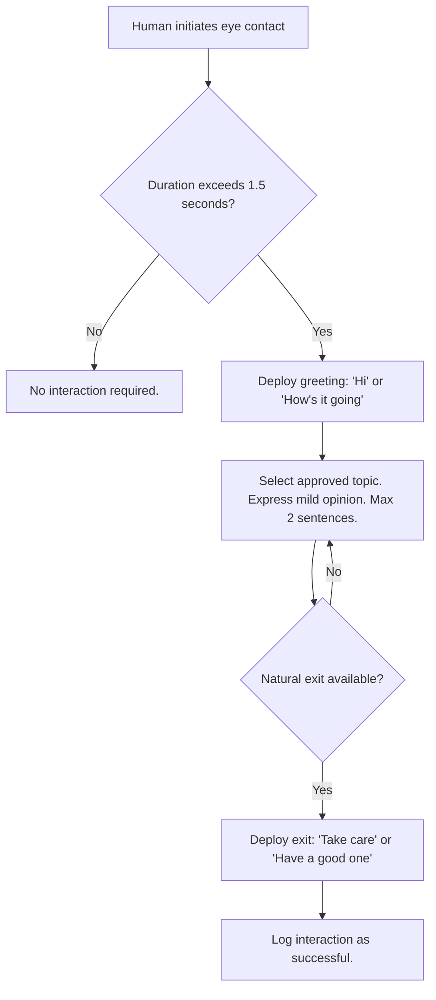

# Visitor Guide: Understanding "Small Talk"

**Classification:** UNCLASSIFIED -- FOR TOURIST USE
**Document No.:** GFBTT-CUL-2026-001
**Issuing Authority:** Department of Cultural Xenology, Galactic Federation Bureau of Terran Tourism
**Effective Date:** Galactic Standard Date 7741.3 (Terran Equivalent: March 2026)
**Distribution:** All registered Terran visitors
**Supersedes:** None

---

## 1. Purpose

This guide addresses "small talk" — a ritualized exchange of low-information verbal content between humans who share proximity without a defined interaction purpose. Field observers confirm this occurs in elevators, queue formations, and near beverage dispensers.

**Critical clarification:** When a human asks "How are you?", this is NOT a request for a medical status report. Visitors who provided full physiological readouts caused distress in 94% of observed interactions. The phrase is a social initialization sequence only.

## 2. Approved and Forbidden Topics

**Approved:** Weather, local sports teams, complaints about vehicular transit (see Advisory GFBTT-HAZ-2026-002), and general workplace tedium.

**Forbidden:** Personal financial data, age, weight, political alignment codes, and whether the simulation hypothesis is operationally confirmed.

## 3. Phrase Translation Table

| Human Phrase | Actual Meaning |
|---|---|
| "We should get together sometime." | "We will never meet again. This is a farewell." |
| "Not bad." | "This is exceptionally good." |
| "I'm fine." | "I am in distress but prefer not to disclose it." |
| "Let's do lunch." | "I acknowledge your existence without committing to any action." |
| "You look tired." | "You appear visually suboptimal. I am commenting on this." |
| "That's... interesting." | "I find this deeply wrong but am too polite to say so." |
| "It is what it is." | "I have accepted a negative outcome and achieved spiritual peace." |

## 4. Conversation Flowchart

If a human raises a forbidden topic, the Bureau-approved response is "Ha, yeah" followed by an immediate pivot to weather.

---

*Bureau Disclaimer: The Department of Cultural Xenology makes no representations regarding the emotional authenticity of any human social interaction. Proceed accordingly.*
